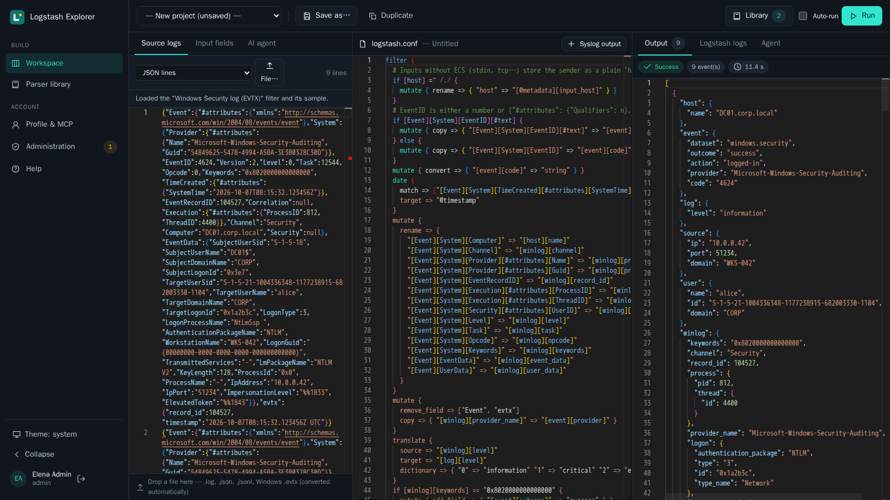
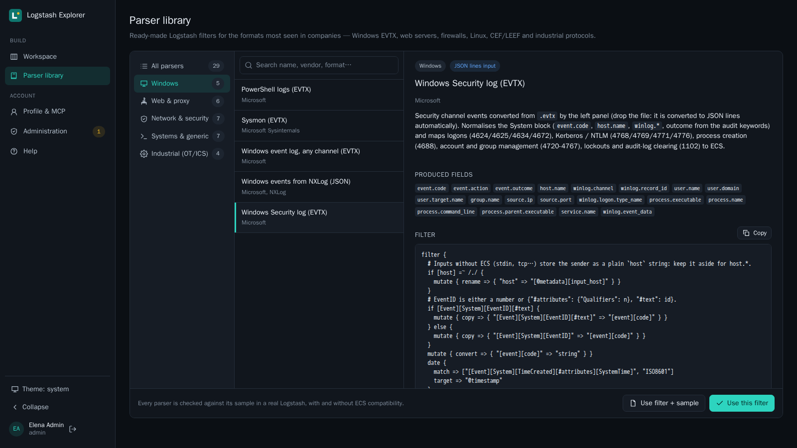
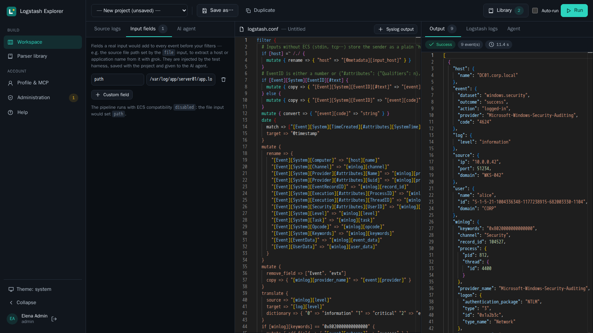
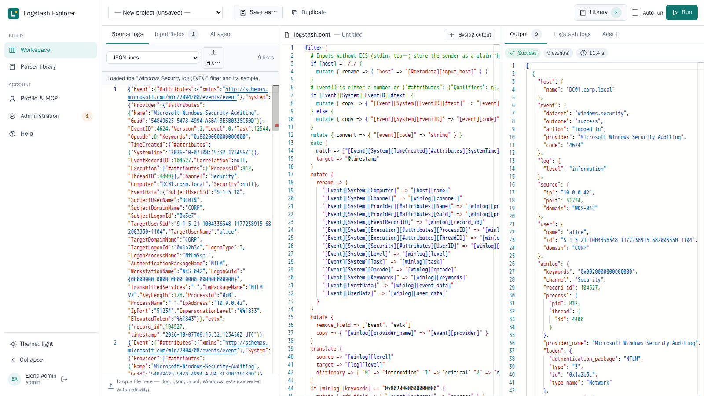
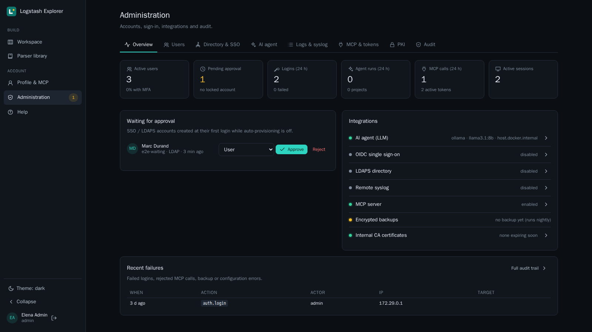
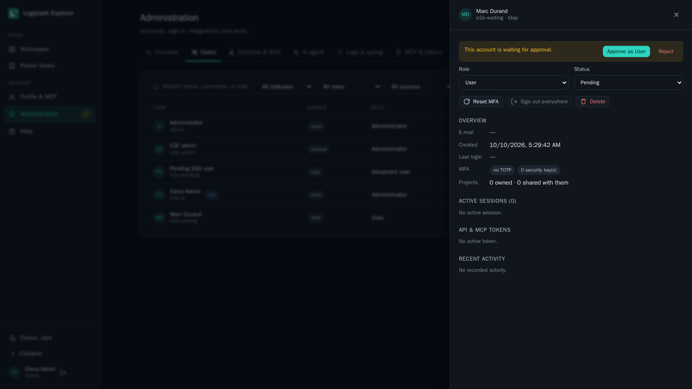
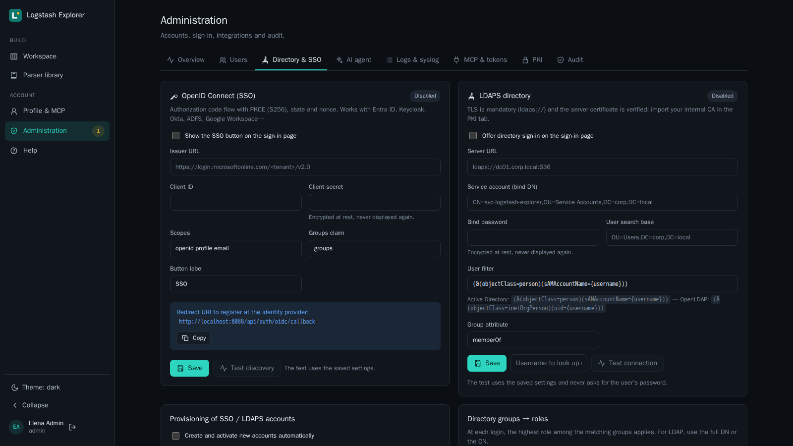
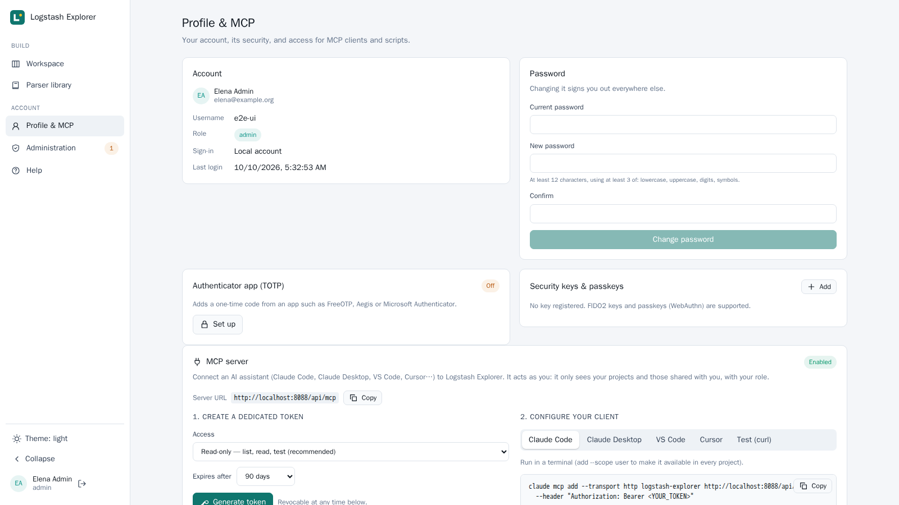
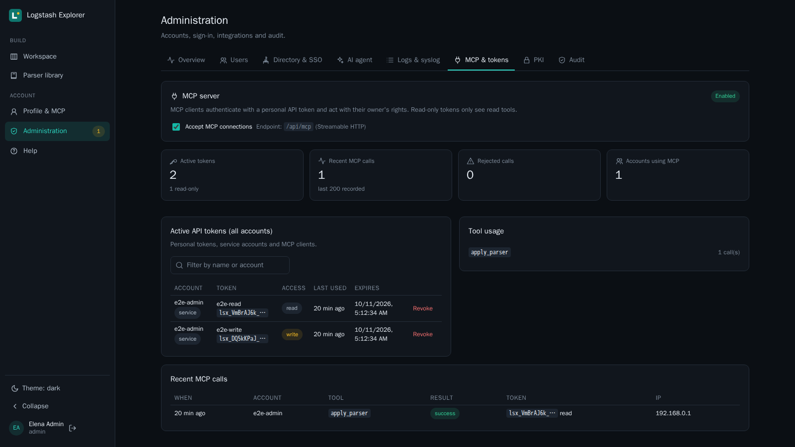
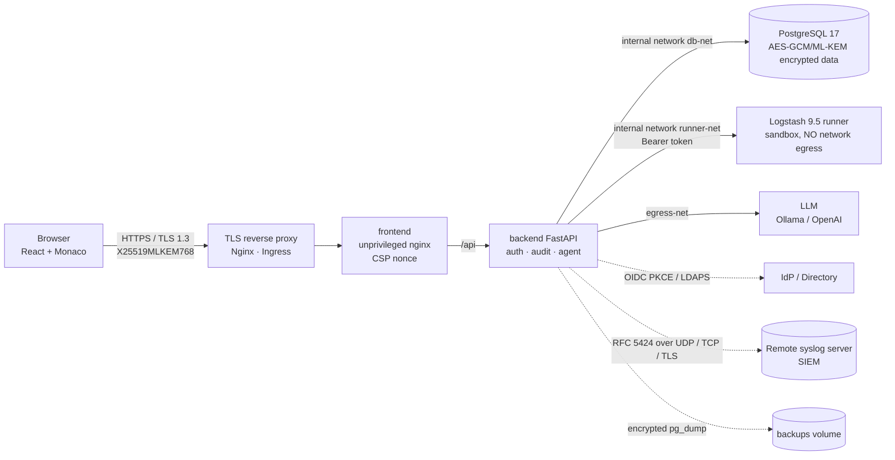

# Logstash Explorer — Secure Logstash AI Tester

Secure web application to **test, parse and automatically fix Logstash configurations**.
Load raw logs, edit `logstash.conf` and see the **actual** Logstash output. An autonomous AI agent
(local Ollama or OpenAI) can also write the configuration, run it, read the errors and fix it in a loop
until it validates. A library of **29 ready-made parsers** (Windows EVTX, web servers, firewalls, Linux,
CEF/LEEF, industrial protocols) detects the format of your logs and gives you a working filter to start from.



| Parser library | Input fields | Light theme |
|---|---|---|
|  |  |  |

| Administration overview | User sheet | Directory & SSO |
|---|---|---|
|  |  |  |

| MCP access (profile) | MCP & tokens (admin) |
|---|---|
|  |  |

- **Frontend**: React 19 + TypeScript + Vite + Monaco Editor (everything bundled, no CDN, works on isolated networks).
- **Backend**: Python 3.14 / FastAPI. Logstash orchestration, native EVTX ingestion, agentic loop.
- **Runner**: ephemeral Logstash 9.5.5 in a sandboxed container, without outbound network.
- **Database**: hardened PostgreSQL 17. Hybrid application-level encryption **AES-256-GCM + X25519/ML-KEM-768**.
- **Proxy**: unprivileged Nginx with a strict per-request nonce CSP. Post-quantum TLS reverse proxy example for Nginx (§6).

---

## 1. Quick start (≤ 5 commands)

No `.env` file is needed: secrets are generated at first start in dedicated volumes.

### Docker
```bash
git clone <repo> logstash-explorer && cd logstash-explorer
docker compose up -d --build
docker compose exec backend cat /run/lsx-secrets/app/admin_initial_password
# → http://localhost:8080 , "admin" account (password change enforced at first login)
```
> Port 8080 already in use? `echo LSX_HTTP_PORT=8088 > .env` before `up` (the public URL follows automatically).
> In Git Bash (Windows), prefix the `exec` command with `MSYS_NO_PATHCONV=1`.

### Podman (rootless)
```bash
git clone <repo> logstash-explorer && cd logstash-explorer
systemctl --user enable --now podman.socket          # Docker-compatible API, rootless
podman compose up -d --build                          # (podman-compose or docker-compose through the socket)
podman compose exec backend cat /run/lsx-secrets/app/admin_initial_password
```
In rootless mode, the containers' UID 1000 is remapped to a subuid range of the host user
(`/etc/subuid`): even a container escape does not lead to root on the host.

### Kubernetes (kubectl)
Images must first be pushed to your registry: adapt `images:` in `deploy/k8s/kustomization.yaml`.
```bash
kubectl apply -f deploy/k8s/namespace.yaml
./deploy/k8s/gen-secrets.sh | kubectl apply -f -
kubectl apply -k deploy/k8s
kubectl -n logstash-explorer get secret lsx-app -o jsonpath='{.data.admin_initial_password}' | base64 -d
```
The namespace enforces the **`restricted` Pod Security Standard** (non-root, `allowPrivilegeEscalation: false`,
capabilities `drop: ALL`, seccomp `RuntimeDefault`, read-only rootfs). **Default-deny** NetworkPolicies
only open the flows shown in the diagram. Expose the `frontend` service through your own TLS ingress (see §6).

---

## 2. Functional architecture



```
 Browser ──TLS1.3(PQ)──► Proxy ──► frontend(nginx:101) ──/api──► backend(FastAPI:1000) ──► PostgreSQL(:70)
                                                                   │  │  └──► LLM (Ollama/OpenAI)   [egress-net]
                                                                   │  └─────► Logstash runner(:1000) [runner-net, internal]
                                                                   └────────► remote syslog / SIEM (UDP, TCP, TLS) [egress-net]
```

| Network      | Members                     | Internet egress |
|--------------|-----------------------------|-----------------|
| `front-net`  | frontend, backend           | yes (port published on 127.0.0.1 only) |
| `db-net`     | backend, db                 | **no** (`internal: true`) |
| `runner-net` | backend, runner             | **no** (`internal: true`) |
| `egress-net` | backend (LLM, IdP, LDAPS)   | yes |

### Agentic loop
1. The user provides source logs, business instructions and, optionally, the expected JSON output.
2. The agent (Ollama/OpenAI) writes a first `filter { … }`.
3. The backend runs Logstash (Input + Conf = Output) in the runner.
4. A deterministic evaluation spots Logstash errors (with line/column), `_grokparsefailure`,
   `_dateparsefailure`… tags, and computes the gap with the expected output (subset comparison,
   `"*"` = any value). Without an expected output, a second LLM call checks compliance with the instructions.
5. Issues, the first events and the tail of the Logstash logs are sent back to the agent, which fixes and
   re-runs until it validates or reaches the maximum number of iterations. Progress is streamed live (NDJSON)
   to the right panel, and the current configuration is synchronized in the central editor.

---

## 3. Backend features

- **Isolated Logstash orchestration**: each run starts an ephemeral Logstash process (dedicated temporary
  directories, strict timeout, process group kill). The input is replaced by stdin and events are always
  captured as JSON lines. Line numbers stay aligned with the editor.
  Rejected: non-allow-listed plugins, `ruby`, `exec`, network plugins, `${ENV}`, file access options.
- **Syslog output check (rsyslog)**: your production `output { syslog { … } }` block is **really**
  executed by `logstash-output-syslog` 3.1.0. Only `host`, `port`, `protocol` and TLS are redirected to a
  TCP/UDP capture local to the runner, so the bytes shown are exactly those that would reach rsyslog. Each
  frame is decoded according to rsyslog properties and checked (RFC 5424 / 3164, length limits, SD-ID,
  escaping, unresolved fields, `maxMessageSize`). Static warnings: unknown facility/severity (silent
  fallback) and the **plugin bug on `local0`–`local7`, `ftp`, `ntp`, `log audit`, `log alert`** (wrong
  facility code, e.g. local0 → 14 instead of 16), with the `use_labels => false` + `priority` workaround.
  Other outputs (elasticsearch…) are ignored.
- **Collaborative projects**: encrypted storage (configuration, sample, instructions, expected output),
  direct link `/?project=<id>`, **duplication** (including from a read-only project), read/write
  **sharing** between colleagues (only the owner shares, renames or deletes).
  **Optimistic locking**: 409 on concurrent editing, then reload, copy or explicit overwrite recorded in
  the audit trail. The editor polls the server every 20 s to report a newer version published by a colleague.
- **Directory group sharing (LDAPS / OIDC)**: a user's groups (`memberOf` in LDAPS, DN and CN, or the
  `groups` claim in OIDC) are stored at each login. An owner can share a project read or write with **a
  group they belong to**; an administrator can target any known group, which avoids exposing the directory
  structure to everyone. The effective right is the highest between personal and group shares. Name
  matching is case-insensitive and keeps the directory's canonical name. Membership is the one seen at the
  last login (sessions of 8 h at most).
- **Concurrent sessions**: several users and tabs in parallel (multiple sessions per account). The runner
  executes up to `RUNNER_CONCURRENCY` (3 by default) Logstash instances in parallel, with a 120 s queue, and
  scales with `docker compose up -d --scale runner=N` (DNS load balancing). Fairness is ensured by a limit
  of `LSX_MAX_RUNS_PER_USER` (2) simultaneous runs/agents per user (HTTP 429 beyond).
- **Parser library**: 29 ready-made filters for the formats most seen in companies, each one checked in a
  real Logstash against its sample with and without ECS compatibility (`scripts/check-parsers.py`):

  | Category | Parsers |
  |---|---|
  | Windows | Security (EVTX), Sysmon (EVTX), PowerShell (EVTX), any EVTX channel, Windows events from NXLog (JSON) |
  | Web & proxy | Apache / Nginx access, Apache error, Nginx error, IIS W3C, Squid, HAProxy |
  | Network & security | Cisco ASA / FTD, FortiGate, Palo Alto PAN-OS, Check Point, Stormshield SNS, CEF, LEEF |
  | Systems & generic | Syslog RFC 3164 and 5424, Linux auth (sshd, sudo, PAM), auditd, JSON lines, key=value, CSV |
  | Industrial (OT/ICS) | Zeek Modbus, Zeek DNP3, Zeek S7comm (CISA ICSNPP), OT security alerts in CEF (Nozomi, Claroty, Dragos…) |

  Filters map to ECS field names. The format of the source logs is **detected automatically** (share of
  matching lines, specific parsers ranked before generic ones) and the matching parser is offered in the
  workspace, given to the AI agent as a starting point and exposed to MCP clients. Samples are synthetic:
  validate the result on your own logs. A parser is a directory `backend/app/parsers/library/<category>/<id>/`
  (`parser.toml`, `filter.conf`, sample) — adding one requires no code change.
- **Input fields**: fields a real input would add to every event before the filters (e.g. the file input's
  `[log][file][path]`, or `path` without ECS) can be declared in the workspace to test filters that extract
  values from them (host, application, environment…). The runner injects them with `add_field` on its
  stdin input after strict validation; they are saved (encrypted) with the project and passed to the agent.
- **Native EVTX**: Windows `.evtx` logs are converted to JSON lines with the Rust `evtx` parser (Python
  binding of `evtx_dump` / evtx2json) as soon as they are uploaded in the left panel.
- **AI agent**: Ollama and OpenAI (or any OpenAI-compatible endpoint). Endpoints, models, keys and
  headers/variables are configured from the administration and encrypted at rest.
  **Model discovery**: the drop-down list is filled by querying the server (`/api/tags` for Ollama with
  size, parameters and quantization; `/v1/models` for OpenAI, filtered to chat models), with automatic
  reload when the URL changes and manual entry possible. The saved key is never sent to a URL other than
  the saved one.
- **Authentication**: local Argon2id accounts with anti-timing and lockout, TOTP (replay protection),
  WebAuthn/passkeys, OIDC (code + PKCE + state + nonce, no open redirect), LDAPS (TLS mandatory),
  service accounts and revocable API tokens, **read-only or read & write** (a read-only token can only
  call GET routes and the side-effect-free POSTs: run, EVTX conversion, format detection, MCP).
- **Directory & SSO in the admin**: OIDC (issuer, client, scopes, groups claim, button label) and LDAPS
  (URL, bind DN, search base, filter, group attribute) are configured in **Administration → Directory &
  SSO**, with the client secret and bind password encrypted at rest, the redirect URI to register, and
  connection tests (OIDC discovery; LDAPS TLS + bind + optional user lookup showing the groups found).
  `LSX_OIDC_*` / `LSX_LDAP_*` variables only seed these settings on first boot.
- **Administration**: overview dashboard (accounts, MFA coverage, logins / agent runs / MCP calls over
  24 h, integrations status, last backup, CA certificates expiring within 30 days, recent failures),
  approval queue for pending SSO / LDAPS accounts (approve with a role, or reject), user search and filters,
  user sheet (role, status, MFA, directory groups, sessions, tokens, projects, recent audit entries, support
  actions such as password / MFA reset and "sign out everywhere"), and an overview of every account's tokens.
- **Roles**: User, Advanced user (AI agent), Administrator. Automatic directory group → role mapping.
  Auto-provisioning toggle: when disabled, new SSO accounts stay "pending".
- **Audit**: logins, MFA, rights, exports, configuration, PKI, backups, with IP, user and context. CSV
  export protected against formula injection.
- **Logging**: JSON on stdout, DEBUG→CRITICAL levels, PII masking toggled from the admin (emails, phone
  numbers, IBAN, cards, NIR).
- **Remote syslog**: application logs and the audit trail can be forwarded in RFC 5424 format to a remote
  syslog server (SIEM, rsyslog, syslog-ng, Graylog…) configured in **Administration → Logs & syslog**:
  UDP, TCP or TLS (RFC 5425), octet-counting or newline framing, facility, optional client certificate for
  mutual TLS. The server certificate is verified against the system CAs plus the CAs imported in the PKI
  tab. Forwarding goes through a bounded in-memory queue and a background thread, so a slow or unreachable
  server never slows requests down: messages are dropped (and counted) and the connection is retried every
  30 s. A test button sends a single message with the saved settings.
- **Scheduled hygiene**: deactivation of inactive accounts (90 days), purge of expired sessions, tokens and
  flows, **encrypted daily backup** (`pg_dump` → authenticated streaming AES-256-GCM, 14-day retention).
- **PKI**: import of PEM CA certificates from the admin (or the `/pki` volume), used for OIDC, LDAPS, LLM and Vault.
- **Secrets**: generated files (default), environment variables (dev) or **HashiCorp Vault KV v2** (production).

### API paths

| Method | Path | Role | Description |
|---|---|---|---|
| GET | `/api/health` | — | Health (DB) |
| GET | `/api/auth/providers` | — | Active providers (local, LDAP, OIDC) |
| POST | `/api/auth/login` · `/api/auth/ldap/login` | — | Local / LDAPS login |
| GET | `/api/auth/oidc/login` · `/api/auth/oidc/callback` | — | OIDC SSO (PKCE) |
| POST | `/api/auth/mfa/totp` · `/api/auth/mfa/webauthn/{options,verify}` | MFA session | Second factor |
| GET | `/api/auth/me` | authenticated | Current user |
| POST | `/api/auth/change-password` · `/api/auth/logout` | authenticated | Password (invalidates every session) / logout |
| GET/DELETE | `/api/me/sessions` | authenticated | Active sessions / close the others |
| POST | `/api/me/totp/{setup,enable,disable}` | authenticated | TOTP |
| GET/POST/DELETE | `/api/me/webauthn…` | authenticated | Security keys / passkeys |
| GET/POST/DELETE | `/api/me/tokens…` | authenticated | Personal API tokens (`scope`: `read` / `write`) |
| GET | `/api/me/mcp` | authenticated | MCP server URL, status and tools available to my role |
| POST | `/api/pipeline/run` | user | Run a configuration on logs (`input_fields` optional) |
| GET | `/api/workspace/settings` | user | Pipeline ECS compatibility mode |
| GET | `/api/parsers[/{id}]` | user | Parser library / one parser (filter, sample, fields) |
| POST | `/api/parsers/detect` | user | Rank library parsers matching a sample |
| POST | `/api/pipeline/evtx` | user | Convert an `.evtx` file to JSON lines |
| GET/POST | `/api/pipelines` | user | My projects + projects shared with me / create |
| GET/PUT/DELETE | `/api/pipelines/{id}` | read / write / owner | Open / save (`version`, `force`) / delete |
| GET | `/api/pipelines/{id}/meta` | read | Current version (concurrent editing detection) |
| POST | `/api/pipelines/{id}/duplicate` | read | Personal copy |
| GET/PUT | `/api/pipelines/{id}/shares` | owner | List / add or change a share (`read`, `write`) |
| DELETE | `/api/pipelines/{id}/shares/{user_id}` | owner | Remove a share |
| GET | `/api/users/directory?q=` | user | Colleague lookup (active accounts, minimal fields) |
| GET/PUT | `/api/pipelines/{id}/group-shares` | owner | Group shares (`source`, `group`, `permission`) |
| DELETE | `/api/pipelines/{id}/group-shares/{share_id}` | owner | Remove a group share |
| GET | `/api/groups/mine` | user | My directory groups (last login) |
| GET | `/api/groups/directory?q=` | user | Shareable groups (mine; all of them for an admin) |
| POST | `/api/agent/run` | advanced | Agentic loop (NDJSON stream) |
| GET | `/api/admin/overview` | admin | Dashboard: accounts, activity, integrations, failures |
| GET/POST/PATCH/DELETE | `/api/admin/users[/{id}]` | admin | Accounts, roles, status |
| GET | `/api/admin/users/{id}/detail` | admin | User sheet (groups, sessions, tokens, projects, audit) |
| POST | `/api/admin/users/{id}/{approve,reject}` | admin | Approve (with a role) or reject a pending account |
| POST | `/api/admin/users/{id}/{reset-password,unlock,reset-mfa,revoke-sessions}` | admin | Support actions |
| GET/DELETE | `/api/admin/tokens[/{id}]` | admin | Active tokens of every account / revoke |
| GET | `/api/admin/directory` | admin | OIDC and LDAPS settings (secrets never returned) |
| PUT/POST | `/api/admin/directory/{oidc,ldap}` · `…/test` | admin | Save / test the directory settings |
| GET/POST/DELETE | `/api/admin/users/{id}/tokens…` | admin | Service account tokens |
| GET/PUT | `/api/admin/settings[/{logging,provisioning,mcp}]` | admin | PII masking, log level, auto-provisioning, MCP on/off |
| GET/PUT/POST | `/api/admin/syslog` · `/api/admin/syslog/test` | admin | Remote syslog forwarding settings, status and test message |
| GET/POST/DELETE | `/api/admin/group-mappings…` | admin | Groups → roles |
| GET/PUT/POST | `/api/admin/ai` · `/api/admin/ai/test` | admin | LLM configuration and test |
| POST | `/api/admin/ai/models` | admin | Models available on the given LLM server (`provider`, `base_url`, `api_key?`) |
| GET/POST/DELETE | `/api/admin/pki…` | admin | Internal CA injection |
| GET | `/api/admin/audit` · `/api/admin/audit/export` | admin | Audit trail / CSV export |
| POST | `/api/mcp` | API token | MCP server (JSON-RPC, stateless Streamable HTTP) |

Authentication through a session cookie (browser) or `Authorization: Bearer lsx_…` (API token).
With `LSX_ENV=development`, the OpenAPI documentation is served on `/api/docs`.

### MCP server

`POST /api/mcp` exposes the application to MCP clients (Claude Code, Claude Desktop, IDEs…) through the
Streamable HTTP transport, in stateless mode (JSON responses, no SSE stream).

- **Identity**: only the user's personal API token (`Authorization: Bearer lsx_…`); session cookies are
  rejected. Revoked or expired token, disabled account or pending password change → rejected. **Profile &
  MCP** generates a dedicated token and shows ready-to-paste configurations for Claude Code, Claude
  Desktop, VS Code and Cursor.
- **Scope**: each tool calls the same handlers as the web UI, with the token's identity. The client
  therefore only sees what the user sees in their session: their projects and those shared with them
  (personally or through a group), with the same read/write rights, and the AI agent only for the
  "advanced" role. Writes are recorded in the audit trail just like from the UI.
- **Tools**: `whoami`, `list_projects`, `get_project`, `run_pipeline`, `list_parsers`, `get_parser`,
  `detect_format`, `apply_parser` (read tools), plus `create_project`, `update_project` (optimistic locking
  on `version`), `duplicate_project` and `run_agent` (advanced role) with a read & write token. Runs and
  projects accept `input_fields`. Deliberately not exposed: deletion, sharing management, tokens and
  administration.
- **Control**: a read-only token only sees the read tools; every tool call is recorded in the audit trail
  (tool, token prefix, outcome); administrators can switch the server off and see / revoke every token in
  **Administration → MCP & tokens**.
- **Protections**: `Origin` header check (DNS rebinding), protocol version check, per-user run quotas
  shared with the UI, submitted values never echoed in errors.

```bash
claude mcp add --transport http logstash-explorer https://lsx.example.org/api/mcp \
  --header "Authorization: Bearer lsx_xxxxxxxx_…"
```

---

## 4. Security measures

| Area | Measure |
|---|---|
| Execution | Every container is non-root (backend/runner `1000:1000`, nginx `101`, postgres `70`), `cap_drop: ALL`, `no-new-privileges`, **read-only** rootfs + tmpfs, memory/PID limits on the runner. No `pip` or package manager in runtime images. |
| Logstash isolation | Runner on an `internal` network (no egress), without DB access or application secrets. Filter plugin allow-list; `ruby`, `exec`, network, `${ENV}` and file options rejected; process environment cleared; network plugins (kafka, elastic_integration, azure) removed from the image. |
| Network | 4 segmented networks; port published on `127.0.0.1` only; default-deny NetworkPolicies on Kubernetes. |
| TLS | TLS 1.3 with the **X25519MLKEM768** hybrid post-quantum key exchange (Nginx/OpenSSL 3.5 example in §6); HSTS `includeSubDomains; preload`. |
| HTTP headers | CSP: `default-src 'none'`, `script-src 'self'` (**no inline script**), `<style>` only with a random per-response nonce, `frame-ancestors 'none'`, `object-src 'none'`, `base-uri 'none'`. Restrictive Permissions-Policy, `nosniff`, `X-Frame-Options: DENY`, COOP/CORP, `Referrer-Policy: no-referrer`. See the CSP note below. |
| Sessions | `HttpOnly; Secure; SameSite=Lax` cookie. Only the SHA3-256 fingerprint is stored server-side. Idle (60 min) and absolute (8 h) expiration. Rotation at login and after MFA. **A password change invalidates every session.** |
| CSRF | Mandatory `X-Requested-With` header on every state-changing cookie-authenticated request, plus an `Origin` check. No CORS. |
| Passwords | Argon2id (64 MiB, t=3, p=4), automatic rehash. Policy: 12 characters minimum, 3 classes, common passwords rejected. |
| Anti-bruteforce | Identical response time (dummy Argon2 verification + 400 ms floor). Lockout after 5 failures for 15 min (MFA included). Per-IP Nginx rate limit (30 req/min, burst 20 — sized for a corporate NAT) on authentication endpoints. |
| Default admin | Random generated password and `must_change_password` enforced at first login. No API access before the change. |
| MFA | TOTP (RFC 6238, per-time-step replay protection), WebAuthn/FIDO2. |
| SSO | OIDC code + PKCE S256, single-use `state`/`nonce`, signature (JWKS), `iss` and `aud` verification, relative redirects only. LDAP: `ldaps://` mandatory, certificate verified, escaped filters, anonymous bind impossible. |
| API tokens | Displayed once, stored as SHA3-256, mandatory expiration (≤ 365 days), revocable. A token cannot create other tokens. |
| Encryption at rest | Hybrid KEM combiner: content key = HKDF-SHA3-256(ss_X25519 ‖ ss_ML-KEM-768 ‖ master_key), then AES-256-GCM with context-bound AAD (column). Encrypted fields: configurations, samples, instructions, emails, TOTP secrets, LLM API keys, OIDC states. Backups: chunked AES-256-GCM, truncation detected. |
| Secrets | Generated by `secrets-init` (no network) in 3 distinct volumes (least privilege). Vault KV v2 support (`LSX_SECRETS_BACKEND=vault`). Never in code nor in `.env`. |
| Logs | Toggleable PII masking (GDPR), persistent audit, RFC 5424 forwarding to a remote syslog server over TLS (server verified, optional client certificate, private key encrypted at rest). Validation errors never echo submitted values. |
| Supply chain | `npm audit --audit-level=critical` as **prebuild** (blocking failure), `npm ci --ignore-scripts`, DOMPurify override, `bandit`, `pip-audit`, `safety` (with key), `ruff`, gitleaks as pre-commit, Trivy (CycloneDX SBOM + CVE) and OpenSCAP through `scripts/security-scan.sh`. |
| Air-gap | Monaco, workers, fonts and icons are bundled in the build; no external resource at runtime. |

> **CSP note** — Monaco (required by the specification) draws editor lines in HTML with
> `style="top:…px"` attributes. These values are too dynamic for hashes, and nonces do not apply to
> attributes. The policy therefore uses CSP level 3 granularity: `style-src-elem 'self' 'nonce-…'`
> (every `<style>` tag requires the nonce) and `style-src-attr 'unsafe-inline'`, restricted to style
> **attributes**. Those cannot execute code, and `img-src 'self' data:` blocks exfiltration through
> `url()`. `script-src` stays strictly `'self'`. Removing `unsafe-inline` entirely would require replacing
> Monaco with CodeMirror 6 (compatible with CSP nonces and CSSOM).

---

## 5. Security & Compliance Scans

**Last check: 2026-10-07** (`logstash-explorer/*:0.1.0` images built the same day).

### Trivy 0.75.0 — CVE and SBOM (CycloneDX)

| Image | OS | CRITICAL | HIGH | MEDIUM | LOW | Fixable HIGH/CRITICAL | Gate |
|---|---|---|---|---|---|---|---|
| `frontend` | Alpine 3.24.2 | 0 | 0 | 0 | 0 | 0 | ✅ |
| `backend` | Debian 13.7 | 0 | 47 | 61 | 85 | **0** | ✅ |
| `runner` | Debian 13.7 | 0 | 44 | 59 | 61 | **0** | ✅ |

- Gate: `--severity HIGH,CRITICAL --ignore-unfixed --exit-code 1`. The remaining HIGH findings are CVEs in
  Debian 13 base packages (util-linux, ncurses, systemd-libs…) **with no published fix**; they will be
  cleared by rebuilding as soon as fixes ship (re-run `scripts/security-scan.sh` regularly).
- Fixed during this cycle: removal of `pip` from runtime images (vulnerable vendored urllib3/msgpack/setuptools)
  and of unused Logstash network plugins (vulnerable jackson-core/databind).
- SBOM: `reports/sbom-{backend,runner,frontend}.cdx.json` (150 / 520 / 71 components).

### OpenSCAP — ANSSI BP-028 profile (minimal), Debian images

| Image | pass | fail | notapplicable | notchecked |
|---|---|---|---|---|
| `backend` | 17 | 14 | 3 | 1 |
| `runner` | 17 | 14 | 3 | 1 |

- **Indicative result**: the available SCAP Security Guide content (`ssg-debian12-ds.xml`) does not cover
  Debian 13 yet. The evaluation was done with `oscap` + `OSCAP_PROBE_ROOT` on each image's exported
  filesystem, with platform detection forced to Debian 12.
- The 14 failures **all** relate to PAM policy and local interactive logins (pam_pwquality, PAM lockout,
  password history, root password age). They do not apply to these images: no login shell, no system
  password, `nologin` user, non-root execution. Application authentication enforces its own equivalent
  policy (Argon2id, lockout, complexity).
- Reports: `reports/oscap-{backend,runner}.{html,xml}`. On a Linux host, `scripts/security-scan.sh` uses
  `oscap-podman` / `oscap-docker` directly.

### Code and dependency analysis (2026-10-07)

| Tool | Scope | Result |
|---|---|---|
| bandit 1.9.4 | `backend/app`, `runner/*.py` | 0 issue |
| pip-audit 2.10.1 | `backend/requirements.txt` | 0 known vulnerability |
| npm audit (critical) | `frontend` | 0 vulnerability |
| ruff 0.16.10 | backend + runner | OK |
| pytest | backend (24) + runner (16) | 40/40 OK |
| Real LDAPS E2E (OpenLDAP + internal CA) | Verified TLS, pending account, role mapping, group sharing, effective rights, revocation | 18/18 OK |
| Multi-user E2E | sharing, rights, duplication, 409 conflict, 429 limit, 3 users in parallel, real syslog | 18/18 OK |
| Headless Chromium | CSP + Monaco + full walkthrough | 0 CSP violation |

The runner rebuilt with `logstash-output-syslog` 3.1.0 passes the Trivy gate again (0 fixable HIGH/CRITICAL).

### Reproduce
```bash
docker compose build
./scripts/security-scan.sh          # bandit, pip-audit, npm audit, Trivy (SBOM + gate), OpenSCAP
```

---

## 6. Configuration

All variables are optional (`LSX_` prefix, see `.env.example` and `backend/app/core/config.py`).

| Variable | Default | Purpose |
|---|---|---|
| `LSX_HTTP_PORT` | `8080` | Port published on 127.0.0.1 |
| `LSX_PUBLIC_URL` | `http://localhost:${LSX_HTTP_PORT}` | Public origin (cookies, WebAuthn, OIDC, CSRF check) |
| `LSX_WEBAUTHN_RP_ID` | `localhost` | WebAuthn domain |
| `LSX_OIDC_*`, `LSX_LDAP_*` | — | First boot only: seed the OIDC / LDAPS settings, then managed in Administration → Directory & SSO |
| `LSX_SECRETS_BACKEND` | `file` | `file`, `env` or `vault` (`LSX_VAULT_ADDR`, `LSX_VAULT_TOKEN_FILE`, `LSX_VAULT_KV_PATH`) |

- **Ollama on the host**: endpoint `http://host.docker.internal:11434` (default value in Administration → AI agent).
- **Connecting an LDAPS directory**:
  1. import the internal CA in **Administration → PKI** (the LDAPS certificate is verified: without the CA,
     the connection is refused);
  2. in **Administration → Directory & SSO**, fill in the URL, service account, password, search base and
     filter, save, then **Test connection** with a username to check the bind and the groups found;
  3. define the group → role mappings and auto-provisioning, then enable directory sign-in.
- **Connecting an OIDC provider**: register the redirect URI shown in **Directory & SSO** at the identity
  provider, enter the issuer, client ID and secret, **Test discovery**, then enable the SSO button.
- **Secrets in production**: store `db_password`, `master_key`, `kem_x25519_sk`, `kem_mlkem768_seed`,
  `runner_token`, and optionally `oidc_client_secret` / `ldap_bind_password` (used when they are not set in
  the admin) in Vault (KV v2), then provide the token through a Vault Agent sidecar.
- **Restoring a backup**: `docker compose exec backend python -m app.cli decrypt-backup /backups/<f>.dump.enc /tmp/db.dump` then `pg_restore`.
### TLS reverse proxy (Nginx)

The stack only listens on `127.0.0.1:${LSX_HTTP_PORT}`: put a TLS reverse proxy in front of it. Example for an
Nginx built against OpenSSL ≥ 3.5 (required for the hybrid post-quantum `X25519MLKEM768` group):

```nginx
server {
    listen 80;
    server_name lsx.example.org;
    return 301 https://$host$request_uri;
}

server {
    listen 443 ssl;
    http2 on;
    server_name lsx.example.org;
    server_tokens off;

    ssl_certificate     /etc/nginx/tls/lsx.example.org.fullchain.pem;
    ssl_certificate_key /etc/nginx/tls/lsx.example.org.key;
    ssl_protocols       TLSv1.3;
    ssl_ecdh_curve      X25519MLKEM768:X25519:secp384r1;  # hybrid post-quantum first, classical fallback
    ssl_session_tickets off;

    # The other security headers (CSP, frame, referrer…) are set by the frontend container.
    add_header Strict-Transport-Security "max-age=63072000; includeSubDomains; preload" always;

    client_max_body_size 25m;  # EVTX uploads (LSX_MAX_UPLOAD_MB=20) + multipart overhead

    location / {
        proxy_pass         http://127.0.0.1:8080;  # LSX_HTTP_PORT
        proxy_http_version 1.1;
        proxy_set_header   Host $host;
        proxy_set_header   X-Forwarded-Proto https;
        proxy_read_timeout 900s;   # long agent runs (UI and MCP run_agent)
        proxy_buffering    off;    # agent progress is streamed as NDJSON
    }
}
```

Then set `LSX_PUBLIC_URL=https://lsx.example.org` and `LSX_WEBAUTHN_RP_ID=lsx.example.org` in `.env` and
restart the stack (`docker compose up -d`). On Kubernetes, expose the `frontend` service through your own TLS
ingress with the same timeout, buffering and body size settings.

## 7. Development

```bash
# Backend (Python 3.14)
cd backend && python -m venv .venv && . .venv/bin/activate && pip install -r requirements-dev.txt
pytest && ruff check . && bandit -c pyproject.toml -r app
# Runner
cd runner && pytest tests
# Parser library: run every parser against its sample in a real Logstash (both ECS modes)
docker run -d --rm --name lsx-runner -p 127.0.0.1:8701:8700 -v <dir with runner_token>:/run/lsx-secrets/runner:ro \
  --tmpfs /tmp:size=1g,exec logstash-explorer/runner:0.1.0
LSX_RUNNER_URL=http://127.0.0.1:8701 LSX_RUNNER_TOKEN=<token> python scripts/check-parsers.py
# Frontend (Node 24) — proxies /api to localhost:8000
cd frontend && npm ci --ignore-scripts && npm run dev
# Hooks
pre-commit install
```

## 8. Known limitations and next steps

- Each run starts a Logstash JVM (~8 s). A possible optimization: a pool of warm Logstash pipelines with
  hot reload.
- The schema is created at startup (`create_all`); add Alembic before the first production migration.
- OpenSCAP: re-run the evaluation with Debian 13 SSG content as soon as it is published.
- The per-user run limit is kept in memory per backend process: with several backend replicas, it applies
  per replica (use a PostgreSQL/Redis counter if needed).
- Group membership is refreshed at login: a group removal in the directory takes effect at the user's next
  login (at most 8 h, the absolute session duration).
- Parser library samples are synthetic, written from vendor documentation: vendor formats vary between
  versions and settings (e.g. PAN-OS columns, FortiOS fields), so check each filter on your own logs.
